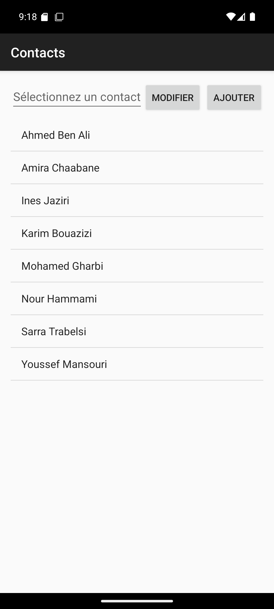
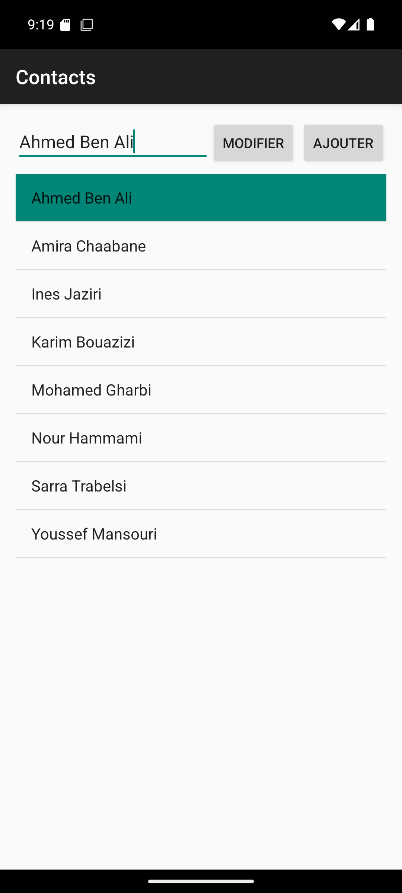
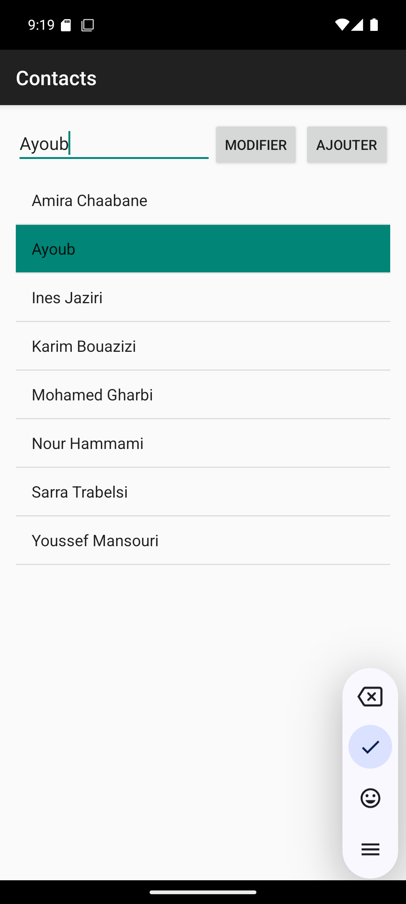
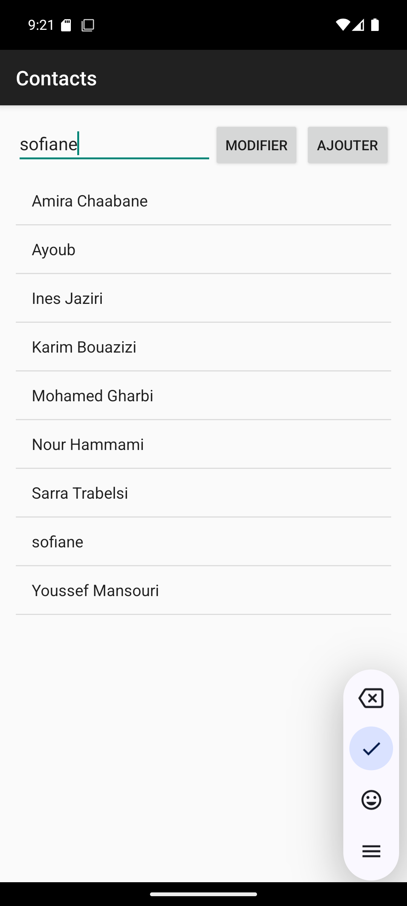

# Contacts ListView

TP Android Kotlin — Ayoub Boussoukaya, L3 DSI

Application qui affiche une liste de contacts dans une ListView. On clique sur un contact, on le modifie dans l'EditText, puis on clique sur **Modifier**.

## Fonctionnalités

- Liste des contacts avec ListView + ArrayAdapter
- Clic sur un contact : il s'affiche en haut et la ligne est surlignée
- Bouton Modifier : met à jour la liste avec `notifyDataSetChanged()`
- Message si aucun contact n'est sélectionné ou si le nom est vide
- Exercices : bouton Ajouter, suppression par appui long (AlertDialog), refus des doublons, tri alphabétique

## Captures

| Liste triée | Sélection | Modification | Ajout |
|:-:|:-:|:-:|:-:|
|  |  |  |  |
